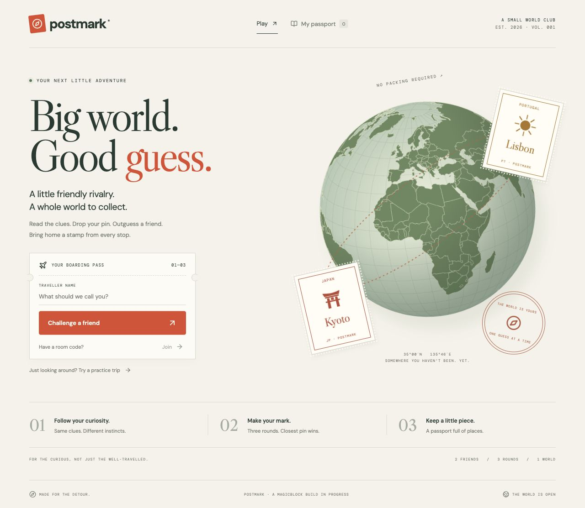

# Postmark

A little friendly rivalry. A whole world to collect.



Postmark combines MagicBlock's Geo Duels and World Passport prompts. Two players interpret the same location clues, place hidden pins, and compare their distance after both lock in. Three rounds earn souvenir stamps in a persistent passport. Practice mode is clearly labelled and uses an automated guide.

## Run locally

Requires Node 22+.

```sh
npm ci
npm run server
# In another terminal:
npm run dev
```

Open http://127.0.0.1:4326. To test two independent identities on one computer, use http://localhost:4326 in a second tab. Create a room in one and join its code in the other. For two separate devices, deploy behind HTTPS; the default listeners are intentionally loopback-only.

```sh
npm test
npm run build
npm run test:api
```

## What is real today

- Playable responsive lobby, multiplayer rooms, three rounds, geography map, results, practice and passport.
- Nine curated locations; distances use the Haversine formula and points use `round(5000 * exp(-distanceKm / 2000))`.
- Guesses stay server-side until both players submit. The location list is public source: this is a casual clue game, not cheat-resistant competitive play.
- With `DATABASE_URL`, the API stores profiles, rooms and passports in PostgreSQL. Write transactions lock the state row so concurrent guesses cannot overwrite each other. Without a database, local development uses atomic file replacement and requires a single server with a persistent volume.
- Anchor program compiles and passed local-validator checks. It implements signer authorization, round sequencing, salted/HMAC guess commitments, bounded oracle scores, delegation, and final commit/undelegation.
- The server contains a MagicBlock adapter. Live devnet deployment and ER-to-Solana proof are **not yet verified**. The hosted game labels its chain integration as pending.

## MagicBlock flow

The server sponsors casual play from a dedicated devnet-only wallet. It creates a match PDA on Solana, delegates it to the MagicBlock validator, locks each guess commitment on the ER, submits bounded scores after both players guess, and commits/undelegates the final result to Solana. Retries preserve pending coordinates and check existing chain state.

The server is the **trusted scoring oracle and transaction signer**. The contract does not independently prove geographic distance, user ownership, or truth of the submitted score. Public ER state is not private; commitments prevent publishing raw guesses during a round. Stamps are saved application souvenirs, not NFTs. There are no wagers, tokens, or real-money payouts.

Program source: `programs/postmark/src/lib.rs`. The client encodes the Anchor ABI explicitly in `server/chain.mjs` and validates account discriminators when reading state.

## Program development

The official Agave tools are installed locally under `.tools/solana/solana-release/bin`. This folder and all keys are ignored. Use an existing official toolchain on other machines; the build script detects the project-local toolchain or a tool on PATH. Override with `POSTMARK_SBF_BUILDER` if needed.

```sh
npm run build:program
# Run a local validator with the compiled program, then:
npm run test:program
```

For devnet, fund only the dedicated test wallet with free test SOL, deploy `target/deploy/postmark_game.so` using `keys/program.json` as the program identity, then run `npm run verify:chain`. That check must produce `submission/chain-evidence.json` with a final base-layer state proof before enabling `POSTMARK_CHAIN=devnet`. No mainnet deployment is configured.

## Limits and outstanding release work

- Devnet faucet rejected two requests on October 10; no test funds or live program deployment confirmed.
- MagicBlock's live portal said “No open events to submit to right now” on October 10. Saved registration notes say Blitz v9 closes October 12; organizer confirmation is required before claiming submission eligibility.
- Public source is available at [ronkenx9/postmark](https://github.com/ronkenx9/postmark); GitHub's application build and gameplay checks passed. The public game is hosted at [postmark-teal.vercel.app](https://postmark-teal.vercel.app). Final video and submission remain outstanding.
- No match expiry/forfeit yet. A disconnected friend can rejoin with their original browser session; losing that session abandons the match.
- Session tokens are browser-local bearer credentials; protect the host with HTTPS. No cross-device account recovery is implemented.
- Runtime dependency audit reports two low and five moderate findings through the official MagicBlock and Solana dependency trees. No high or critical findings. Do not perform a blind major-version upgrade; recheck compatibility and the relevant call paths before public release.

## Sources and credits

- [MagicBlock build portal](https://build.magicblock.app/?stage=blitz)
- [Official Anchor counter example](https://github.com/magicblock-labs/magicblock-engine-examples/tree/main/counter/anchor)
- [MagicBlock documentation](https://docs.magicblock.gg/)
- World geometry: `world-atlas` / Natural Earth. Projection and map rendering: D3 Geo. Icons: Lucide. Fonts: DM Sans, DM Mono, Libre Caslon Display via Google Fonts.

## Single-server deployment

The backend serves the built frontend and API from one port. `npm run build` followed by `HOST=0.0.0.0 npm run server` is sufficient behind an HTTPS reverse proxy. Use `POSTMARK_DATA_DIR` for a persistent directory. The included Dockerfile builds both; attach a persistent volume to `/data`. The Docker configuration is prepared but has not been container-tested on this Mac.

## Interactive globe

The landing and match screens now render a Three.js sphere with locally generated Natural Earth geography. Drag to rotate, wheel/pinch or use buttons to zoom, and click/tap to place a pin. Drag gestures do not place guesses. Locked rounds disable placement; reveal shows both pins and curved paths to the destination. Coordinate fields remain available for keyboard use and devices without WebGL. Rendering is on demand, with no perpetual idle animation. Desktop mouse input and 390px layout were verified; physical multi-touch testing remains outstanding.

## Vercel hosting

`vercel.json` deploys the Vite frontend and the API together. Connect a dedicated PostgreSQL database and set `DATABASE_URL` in Vercel production. No wallet secrets are needed for casual play. The API creates its own state table on first use; never expose the connection string through a Vite-prefixed variable.

The database adapter keeps the demo state in one JSONB row, with transactional locking. This is appropriate for a small hackathon demo, not high-volume production: split profiles and matches into separate rows before scaling. Chain-enabled serverless hosting is deliberately blocked until durable transaction recovery is verified; the local chain adapter remains available for devnet qualification.

To verify a deployment:

```sh
POSTMARK_URL=https://your-site.vercel.app npm run test:api
POSTMARK_URL=https://your-site.vercel.app POSTMARK_SECOND_URL=https://your-site.vercel.app node scripts/verify-concurrency.mjs
```

## Tutorial

First-time visitors see a four-step interactive tutorial: rotate and zoom, place and lock a practice pin, inspect the reveal, then learn scoring and passport rewards. It can be skipped or closed with Escape and reopened using **How to play**. Tutorial actions do not create a match or award stamps.
